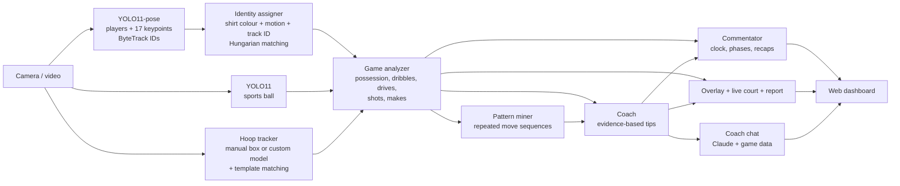

# HoopVision 🏀

**A 1v1 basketball tracker, live commentator and AI coach that runs on a phone or laptop camera.**

HoopVision watches a 1v1 game, puts game-style hitboxes on **YOU**, your **OPPONENT** and the **HOOP**,
draws both players on a top-down **LIVE COURT**, narrates the game with a running clock, and
works out how each player plays: which way they drive, which hand they dribble with, what they do after a
crossover, where they shoot from and how often it goes in. It then mines the opponent's possessions for
plays they keep repeating and turns all of that into specific advice, e.g.

> **Force them right.** They drive left most of the time. Shade half a step to their left and make them go
> right, so they have to beat you with their weaker side. *(evidence: drives left: 5/6 (83%))*
>
> **Their go-to play: R-hand > cross L > drive L > layup.** When you see the first move, jump ahead to
> the last one. *(evidence: seen in 3 possessions)*

<!-- Add a GIF of your own footage here: it is the best thing on this page. -->

## Features

- **Web dashboard**: the tracked video with the LIVE COURT minimap underneath, an **AI commentary** feed,
  and a **coach chat** where you can ask Claude how to beat your opponent, grounded in the game data.
- **Commentary with a session clock** that walks through three phases:
  *Calibrating* (finding the hoop, locking onto both players and their shirt colours, spotting the ball),
  *Scouting* (a recap of every possession while it watches the opponent's first N possessions), and
  *Game plan ready* (tendencies and repeated plays are called out as `PATTERN` lines as they appear).
  With an API key, Claude adds short `AI` analyst lines every ~30 seconds.
- **Score tracking**: detected makes score automatically (1s and 2s by default, `--scoring 2s3s` for
  2s and 3s, using the three-point arc), with games played to `--game-to` (and `--win-by 2` if you want it).
  You get "game point" and "game over" calls, games won across a series, and the score on screen, in the
  commentary and in the report. The camera will miss the odd make, so the dashboard has **+1 / −1 / Undo**
  buttons (keys `1`, `2`, `u` in the OpenCV window).
- **Ball tracking**: a Kalman filter follows the ball through blur and hands. It ignores stray "balls" in
  the background, keeps predicting during short dropouts (shown as a dimmed `BALL?` box), jumps to the ball
  when it reappears somewhere new (e.g. picked up under the net), and when the full-frame detector misses
  it, re-runs detection on a zoomed crop around where the ball should be. The live court shows who has it.
- **Live tracking overlay**: corner-bracket hitboxes with name tags, ball trail, pose skeletons (optional),
  a live scoreboard (FG, drives, crossovers), an event feed and a coaching banner that updates as you play.
- **Robust YOU/OPPONENT identity**: each player gets a shirt-colour signature plus a motion model, matched
  every frame with the Hungarian algorithm, so labels survive tracker ID switches, crossings and players
  leaving the frame.
- **Basketball event detection** from pose keypoints and the ball: possessions, dribbles (with the hand),
  crossovers, drives (left/right/straight relative to the rim), blow-bys, shots typed as
  layup / pull-up / stepback / spot-up / jumper, makes and misses, and turnovers.
- **Pattern mining**: each possession becomes a move sequence (`start:right → dribble:R → crossover>L →
  drive:left → shot:layup`) and the opponent's repeated sequences are found by n-gram support counting.
- **Evidence-based coach**: rules with minimum sample sizes; every tip says what it's based on.
- **Scouting report** at the end of a session: Markdown + JSON, a position heatmap and a shot chart.

## Quick start

```bash
python -m venv .venv && source .venv/bin/activate
pip install -r requirements.txt

# Web dashboard: video + live court + AI commentary + coach chat
python -m hoopvision --web --source 0 --opp-name WEMBY
# then open http://localhost:8000 (it opens automatically)

# Plain OpenCV window (commentary prints to the terminal)
python -m hoopvision --source 0

# A video you recorded on your phone
python -m hoopvision --source game.mp4 --save annotated.mp4
```

YOLO weights (`yolo11n-pose.pt`, `yolo11n.pt`) download automatically on first run.

### Coach chat setup (optional)

The chat and AI commentary use Claude (`claude-opus-5-5` by default, `--model` to change it). Set an
API key from [console.anthropic.com](https://console.anthropic.com):

```bash
export ANTHROPIC_API_KEY=sk-ant-...
```

Without a key everything still works: the chat answers from the rule-based coach, and the commentary
stays deterministic. `--no-ai` forces offline mode, and `--no-ai-commentary` keeps the chat but skips the
AI analyst lines. Only the computed game stats and the commentary text are sent to the API, never video
frames. After a session you can keep chatting about it:
`python -m hoopvision.chat runs/<timestamp>/report.json`.

### Calibrating

In the dashboard, click **Select hoop** and drag a box around the rim (in the OpenCV window you're asked
on the first frame). YOU is whoever starts on the left (`--you-side right` to flip). If it picked the wrong
player, click **That's me** and then yourself, or hit **Swap players**. The commentary tells you what it's
still looking for.

OpenCV window keys:

| Key | Action |
| --- | --- |
| click | mark that player as YOU |
| `s` | swap YOU / OPPONENT |
| `1` / `2` | add a point to YOU / OPPONENT (a make the camera missed) |
| `u` | undo the last score change |
| `h` | re-select the hoop |
| space | pause |
| `q` | quit and write the report |

The report lands in `runs/<timestamp>/report.md`.

### Using your phone as the camera

- **Android**: install *IP Webcam*, start the server, then
  `python -m hoopvision --source http://<phone-ip>:8080/video` (phone and laptop on the same Wi-Fi).
- **iPhone + Mac**: Continuity Camera shows the phone up as a normal webcam (`--source 1`), or use an app
  such as DroidCam / EpocCam and pass its URL or camera index.
- Or just record the game and run HoopVision on the file afterwards, which also lets a slow laptop
  analyse every frame.

### Filming tips

- Put the phone on a tripod or a ledge **at half court looking at the hoop**, so both players and the rim
  are in shot. If the phone is behind the hoop looking out at the players, add `--camera-behind-hoop`.
- **Wear different coloured shirts.** Identity tracking relies on it when you're tangled up.
- 720p or 1080p at 30 fps is plenty.

### Useful options

```
--you-name / --opp-name labels on the hitboxes and court, e.g. --opp-name WEMBY
--scoring 1s2s|2s3s     points per make inside / behind the arc (default 1s2s)
--game-to 11 --win-by 2 game length and winning margin
--scout-possessions 5   opponent possessions to watch before the game plan is "ready"
--no-court              hide the LIVE COURT minimap
--hoop x,y,w,h          give the hoop location instead of selecting it (headless runs)
--hoop-weights best.pt  detect the hoop automatically with a custom model (see below)
--no-display            run without a window (e.g. on a server)
--skeleton              draw pose skeletons
--device mps|0|cpu      Apple GPU, CUDA GPU, or CPU
--width 960             process smaller frames for more FPS
```

## How it works



| Module | What it does |
| --- | --- |
| `detection.py` | Runs YOLO pose (players, keypoints, ByteTrack IDs), the COCO "sports ball" class, and an optional custom hoop model. |
| `hoop.py` | Keeps a stable hoop box: smoothing plus template matching to follow small camera shake. |
| `identity.py` | Torso HSV histograms (Bhattacharyya distance) + constant-velocity prediction + track-ID bonus → Hungarian assignment. It only updates a shirt signature when the players don't overlap, so their colours don't bleed into each other. |
| `ball.py` | Constant-velocity Kalman filter over ball detections: gating against false positives, coasting through dropouts, re-anchoring on a consistent new detection, and a search region for zoomed re-detection. Only real measurements reach the analyzer, so predictions can't fake a dribble or a make. |
| `scoring.py` | Points per make (inside / behind the arc), game-to / win-by, game point and game over, series, manual corrections and undo. |
| `court.py` | Converts pixels into hoop-relative court coordinates measured in *body heights*, using each player's own height as a ruler, and buckets positions into zones (paint, left/top/right mid-range and perimeter). |
| `analyzer.py` | The state machine that turns frames into events: possession with hysteresis, dribble bounces (ball's lowest point below the hips) and which wrist is closest, crossovers, drives (direction from the cross product of movement against the line to the rim), blow-bys, shots (ball rising above the head), makes (ball seen above the rim, then below it inside the rim's width). |
| `patterns.py` | Counts contiguous move n-grams per possession and keeps the maximal ones. |
| `coach.py` | Rules that turn tendencies into advice, each gated by a minimum sample size. |
| `overlay.py`, `court_view.py`, `report.py` | HUD drawing, the top-down LIVE COURT, and the Markdown/JSON report with heatmap and shot chart. |
| `commentary.py` | Calibrating → Scouting → Game plan ready state machine with a session clock; possession recaps and new-pattern callouts. |
| `chat.py` | Claude coach: each question is sent with a fresh JSON snapshot of the stats, repeated plays, tips and recent commentary (append-only history, cached system prompt, streamed answers). Falls back to an offline coach. Also the optional AI analyst. |
| `server.py`, `web/index.html` | Flask dashboard: MJPEG video stream, polling for clock and commentary, streamed chat, and click/drag tools for the hoop and "that's me". |

The analytics layer only consumes plain dataclasses (`structures.py`), so it is unit-tested with a
synthetic scene generator (`tests/sim.py`): no camera, GPU or model needed.

```bash
pip install -r requirements-dev.txt
pytest
```

## Automatic hoop detection (optional)

COCO doesn't have a hoop class, which is why you select it by hand. To detect it automatically, fine-tune
a small model on a hoop dataset (Roboflow Universe has several) and pass it in:

```bash
python scripts/train_hoop_detector.py --data hoop-dataset/data.yaml
python -m hoopvision --source game.mp4 --hoop-weights runs/detect/hoop/weights/best.pt
```

If that model also has a ball class, it is used whenever it is more confident than COCO's ball detector.
That helps a lot, because COCO's "sports ball" struggles with a small, blurry basketball.

## Limitations and what's next

- **Single uncalibrated camera.** Distances are estimated in body heights, so zones are approximate.
  Next step: click 4 court landmarks once to get a homography and real court coordinates.
- **Ball detection is still the weakest link** with stock COCO weights (motion blur, occlusion by hands).
  The tracker and zoomed re-search help, but a basketball-specific model (see below) helps most, and it
  feeds straight into scoring.
- **Automatic scoring relies on seeing the ball go through the rim**, so keep the hoop well in frame and use
  the +1 / undo buttons when it misses one. Whether a shot is behind the arc comes from the approximate
  court distance, so close calls can be wrong.
- **Thresholds are hand-tuned** (see `AnalyzerConfig`). Labelling a few games would allow evaluating
  event precision/recall and tuning them properly.
- Ideas: LLM-written scouting summaries from `report.json`, a mobile app using an on-device model
  (CoreML/TFLite export), multi-session history to track progress against the same opponent.
