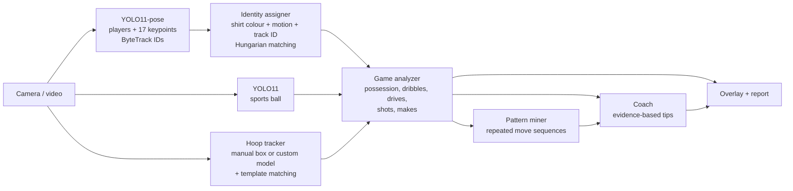

# HoopVision 🏀

**A 1v1 basketball tracker and scouting coach that runs on a phone or laptop camera.**

HoopVision watches a 1v1 game, puts game-style hitboxes on **YOU**, your **OPPONENT** and the **HOOP**, and
works out how each player plays: which way they drive, which hand they dribble with, what they do after a
crossover, where they shoot from and how often it goes in. It then mines the opponent's possessions for
plays they keep repeating and turns all of that into specific advice, e.g.

> **Force them right.** They drive left most of the time. Shade half a step to their left and make them go
> right, so they have to beat you with their weaker side. *(evidence: drives left: 5/6 (83%))*
>
> **Their go-to play: R-hand > cross L > drive L > layup.** When you see the first move, jump ahead to
> the last one. *(evidence: seen in 3 possessions)*

<!-- Add a GIF of your own footage here: it is the best thing on this page. -->

## Features

- **Live tracking overlay**: corner-bracket hitboxes with name tags, ball trail, pose skeletons (optional),
  a live scoreboard (FG, drives, crossovers), an event feed and a coaching banner that updates as you play.
- **Robust YOU/OPPONENT identity**: each player gets a shirt-colour signature plus a motion model, matched
  every frame with the Hungarian algorithm, so labels survive tracker ID switches, crossings and players
  leaving the frame.
- **Basketball event detection** from pose keypoints and the ball: possessions, dribbles (with the hand),
  crossovers, drives (left/right/straight relative to the rim), blow-bys, shots typed as
  layup / pull-up / stepback / spot-up / jumper, makes and misses, and turnovers.
- **Pattern mining**: each possession becomes a move sequence (`start:right → dribble:R → crossover>L →
  drive:left → shot:layup`) and the opponent's repeated sequences are found by n-gram support counting.
- **Evidence-based coach**: rules with minimum sample sizes; every tip says what it's based on.
- **Scouting report** at the end of a session: Markdown + JSON, a position heatmap and a shot chart.

## Quick start

```bash
python -m venv .venv && source .venv/bin/activate
pip install -r requirements.txt

# Laptop webcam
python -m hoopvision --source 0

# A video you recorded on your phone
python -m hoopvision --source game.mp4 --save annotated.mp4
```

YOLO weights (`yolo11n-pose.pt`, `yolo11n.pt`) download automatically on first run.

On the first frame you'll be asked to **drag a box around the hoop** (rim + net), then press Enter.
YOU is whoever starts on the left (`--you-side right` to flip), or just **click on yourself** in the
window at any time.

| Key | Action |
| --- | --- |
| click | mark that player as YOU |
| `s` | swap YOU / OPPONENT |
| `h` | re-select the hoop |
| space | pause |
| `q` | quit and write the report |

The report lands in `runs/<timestamp>/report.md`.

### Using your phone as the camera

- **Android**: install *IP Webcam*, start the server, then
  `python -m hoopvision --source http://<phone-ip>:8080/video` (phone and laptop on the same Wi-Fi).
- **iPhone + Mac**: Continuity Camera shows the phone up as a normal webcam (`--source 1`), or use an app
  such as DroidCam / EpocCam and pass its URL or camera index.
- Or just record the game and run HoopVision on the file afterwards, which also lets a slow laptop
  analyse every frame.

### Filming tips

- Put the phone on a tripod or a ledge **at half court looking at the hoop**, so both players and the rim
  are in shot. If the phone is behind the hoop looking out at the players, add `--camera-behind-hoop`.
- **Wear different coloured shirts.** Identity tracking relies on it when you're tangled up.
- 720p or 1080p at 30 fps is plenty.

### Useful options

```
--hoop x,y,w,h          give the hoop location instead of selecting it (headless runs)
--hoop-weights best.pt  detect the hoop automatically with a custom model (see below)
--no-display            run without a window (e.g. on a server)
--skeleton              draw pose skeletons
--device mps|0|cpu      Apple GPU, CUDA GPU, or CPU
--width 960             process smaller frames for more FPS
```

## How it works



| Module | What it does |
| --- | --- |
| `detection.py` | Runs YOLO pose (players, keypoints, ByteTrack IDs), the COCO "sports ball" class, and an optional custom hoop model. |
| `hoop.py` | Keeps a stable hoop box: smoothing plus template matching to follow small camera shake. |
| `identity.py` | Torso HSV histograms (Bhattacharyya distance) + constant-velocity prediction + track-ID bonus → Hungarian assignment. It only updates a shirt signature when the players don't overlap, so their colours don't bleed into each other. |
| `court.py` | Converts pixels into hoop-relative court coordinates measured in *body heights*, using each player's own height as a ruler, and buckets positions into zones (paint, left/top/right mid-range and perimeter). |
| `analyzer.py` | The state machine that turns frames into events: possession with hysteresis, dribble bounces (ball's lowest point below the hips) and which wrist is closest, crossovers, drives (direction from the cross product of movement against the line to the rim), blow-bys, shots (ball rising above the head), makes (ball seen above the rim, then below it inside the rim's width). |
| `patterns.py` | Counts contiguous move n-grams per possession and keeps the maximal ones. |
| `coach.py` | Rules that turn tendencies into advice, each gated by a minimum sample size. |
| `overlay.py`, `report.py` | HUD drawing; Markdown/JSON report, heatmap and shot chart. |

The analytics layer only consumes plain dataclasses (`structures.py`), so it is unit-tested with a
synthetic scene generator (`tests/sim.py`): no camera, GPU or model needed.

```bash
pip install -r requirements-dev.txt
pytest
```

## Automatic hoop detection (optional)

COCO doesn't have a hoop class, which is why you select it by hand. To detect it automatically, fine-tune
a small model on a hoop dataset (Roboflow Universe has several) and pass it in:

```bash
python scripts/train_hoop_detector.py --data hoop-dataset/data.yaml
python -m hoopvision --source game.mp4 --hoop-weights runs/detect/hoop/weights/best.pt
```

If that model also has a ball class, it is used whenever it is more confident than COCO's ball detector.
That helps a lot, because COCO's "sports ball" struggles with a small, blurry basketball.

## Limitations and what's next

- **Single uncalibrated camera.** Distances are estimated in body heights, so zones are approximate.
  Next step: click 4 court landmarks once to get a homography and real court coordinates.
- **Ball detection is the weakest link** with stock COCO weights (motion blur, occlusion by hands). A
  basketball-specific model, or a Kalman filter on the ball, would improve dribble and shot detection.
- **Thresholds are hand-tuned** (see `AnalyzerConfig`). Labelling a few games would allow evaluating
  event precision/recall and tuning them properly.
- Ideas: LLM-written scouting summaries from `report.json`, a mobile app using an on-device model
  (CoreML/TFLite export), multi-session history to track progress against the same opponent.
